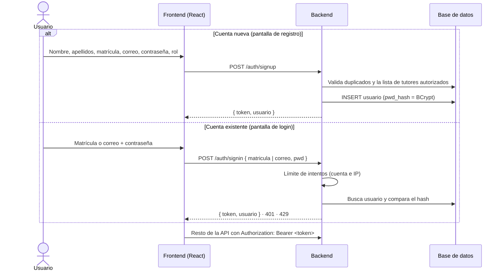

# Autenticación con matrícula o correo y contraseña

El usuario entra con su **matrícula o su correo** y una **contraseña** que guarda el backend (cifrada con BCrypt). Si las credenciales son correctas, el backend entrega su **propio JWT**, que es el que se usa en el resto de la API.

El login con Microsoft y Google (OpenID Connect) se retiró en octubre de 2026: el frontend ya no lo usa. Las columnas `proveedor` e `id_externo` siguen en la tabla `usuario` para las cuentas que se crearon con él (ver [§ 6](#6-cuentas-creadas-con-microsoft-o-google)).

## 1. Flujo



Detalle de bodies, respuestas y mensajes de error: [API.md § 1](API.md#1-autenticación--auth-público).

## 2. Contraseñas

- Se guardan en `usuario.pwd_hash` con **BCrypt** (`BCryptPasswordEncoder` de Spring Security, costo 10). Nunca en texto plano, ni en logs, ni en una respuesta: `UsuarioResponsive` no expone el hash.
- Entre **8 y 72 caracteres**. BCrypt solo usa los primeros 72 bytes, así que una contraseña con más bytes (p. ej. muchos caracteres acentuados o emojis) se rechaza en el signup en lugar de truncarse en silencio.
- El signin responde **el mismo mensaje y el mismo código** (`401 Usuario o contraseña incorrectos.`) si la cuenta no existe, si la contraseña está mal o si la cuenta aún no tiene contraseña. Cuando la cuenta no existe, igual se calcula un BCrypt contra un hash señuelo, para que el tiempo de respuesta no delate qué matrículas o correos están registrados.
- No hay recuperación de contraseña todavía. Mientras tanto, un admin puede asignar una nueva desde la BD ([§ 5](#5-administradores)).

### Límite de intentos (fuerza bruta)

`LimiteIntentos` cuenta los signin **fallidos** en una ventana fija de 15 minutos:

| Llave | Máximo | Nota |
|---|---|---|
| Cuenta | 5 | Se cuenta por matrícula aunque se entre por correo: alternar los dos no da más intentos. |
| IP | 30 | IP real del cliente detrás del proxy de Render (`server.forward-headers-strategy=native`). |

Al llegar al máximo, esa llave recibe `429 Demasiados intentos fallidos. Intenta de nuevo en N minutos.` hasta que termina la ventana, **aunque la contraseña sea correcta**. Un login correcto limpia el contador de la cuenta.

Los valores se cambian en `application.properties` (`auth.intentos.*`). El contador vive en memoria: sirve para una sola instancia y se reinicia en cada despliegue. Si el backend escala a varias instancias, habría que moverlo a la BD o a Redis.

## 3. Estados de una cuenta

La restricción `ck_usuario_credencial` (en `001_esquema.sql` y `004_contrasenas.sql`) solo admite tres combinaciones:

| Estado | `proveedor` | `id_externo` | `pwd_hash` | ¿Puede iniciar sesión? |
|---|---|---|---|---|
| Pre-registro | `NULL` | `NULL` | `NULL` | No. El signup la reclama. |
| Con contraseña | `LOCAL` | `NULL` | BCrypt | Sí |
| Cuenta de Microsoft/Google | `MICROSOFT` · `GOOGLE` | `sub` | `NULL` | No. El signup la reclama. |

**Reclamar** una cuenta sin contraseña: `POST /auth/signup` con su matrícula y **el mismo correo** le asigna contraseña, pasa a `LOCAL` y conserva su rol e historial. Nombre y apellidos se toman del body.

## 4. Quién puede darse de alta como tutor

El signup acepta `TUTORADO` o `TUTOR`; `ADMIN` nunca. Un `TUTOR` puede publicar tutorías, pasar lista y aplicar bajas automáticas a tutorados reales, así que **solo se da de alta si está en la lista de tutores autorizados**:

1. El admin pre-registra la matrícula y el correo con `POST /admin/tutores` (o por SQL). La fila queda como `TUTOR` sin contraseña.
2. La persona hace `POST /auth/signup` con `rol: "TUTOR"`, esa matrícula y ese correo, y elige su contraseña.
3. Si la matrícula no está en la lista, el signup responde `400` con `data.rol: "Tu matrícula no está autorizada como tutor. Pide al administrador que te registre."`.

`DELETE /admin/tutores/{matricula}` quita un pre-registro que todavía no crea su cuenta.

La regla vive en el backend: aunque el front oculte el selector de rol, cualquiera puede llamar a la API directamente.

> **Riesgo conocido:** el signup no verifica que la persona controle el correo. Quien conozca la matrícula y el correo institucional de un tutor pre-registrado (o de una cuenta de Microsoft/Google) podría reclamarla antes que su dueño. Para cerrarlo hay que confirmar el correo (código o enlace enviado por SendGrid) antes de activar la cuenta. Mientras no exista, conviene pre-registrar a los tutores poco antes de que creen su cuenta y revisar que cada uno pueda entrar.

## 5. Administradores

El rol `ADMIN` nunca se asigna desde la API. Su matrícula no tiene el formato `S` + 8 dígitos, así que tampoco pasa por el signup. Se crean y se les asigna contraseña en la BD. Supabase trae `pgcrypto` en el esquema `extensions`, y `crypt(..., gen_salt('bf'))` genera un hash `$2a$` que el backend acepta tal cual:

```sql
-- Alta (si no existe)
INSERT INTO usuario (matricula, nombre, apellidos, correo, id_rol)
VALUES ('25480', 'Adriana', 'Salas Ortega', 'asalas@uv.mx',
        (SELECT id_rol FROM rol WHERE rol = 'ADMIN'));

-- Contraseña (también sirve para restablecer la de cualquier usuario)
UPDATE usuario
SET proveedor = 'LOCAL', id_externo = NULL,
    pwd_hash = extensions.crypt('<contraseña>', extensions.gen_salt('bf', 10))
WHERE matricula = '25480';

-- Promover a alguien que ya tiene cuenta
UPDATE usuario SET id_rol = (SELECT id_rol FROM rol WHERE rol = 'ADMIN')
WHERE matricula = '25480';
```

En PostgreSQL local, `pgcrypto` se activa con `CREATE EXTENSION pgcrypto;` y las funciones se llaman sin el prefijo `extensions.`.

Recomendaciones:

- mantener los endpoints de admin bajo `/admin/**` con `hasRole('ADMIN')`;
- usar un JWT de menor vigencia para `ADMIN`;
- registrar en una bitácora las acciones de admin (alta o baja de EE, desactivar tutorías, pre-registro de tutores).

## 6. Cuentas creadas con Microsoft o Google

Las cuentas registradas con el login anterior tienen `proveedor` = `MICROSOFT` o `GOOGLE` y no tienen contraseña, así que **no pueden iniciar sesión** hasta que la reclaman con el signup ([§ 3](#3-estados-de-una-cuenta)). Su historial (inscripciones, tutorías, asistencia) se conserva porque la matrícula no cambia.

Si algún día se vuelve al login institucional, la app de Entra ID sigue registrada en el tenant de la UV (cliente `8b9904dc-704e-4d58-a605-891edeef4df3`, tenant `3c907651-d8c6-4ca6-a8a4-6a242430e653`). El código anterior está en el historial de git, antes del commit que agregó `/auth/signin`.

## 7. JWT de sesión

Después de validar la contraseña, el backend emite su propio JWT (HS256):

| Claim | Valor |
|---|---|
| `sub` | Matrícula (`"S23014587"`) |
| `rol` | `TUTORADO` · `TUTOR` · `ADMIN` |
| `tipo` | `SESION` |
| `iat`, `exp` | Emisión y expiración (`API_JWT_EXPIRATION`) |

- Se envía como `Authorization: Bearer <token>`. El frontend toma el rol y la matrícula **del token**.
- No hay refresh token: al llegar a `exp`, el frontend cierra la sesión.
- **Cerrar sesión:** el frontend descarta el token (la API no guarda sesiones).
- Si el rol cambia en la BD, el cambio aplica en el siguiente login.
- `/auth/**` ignora el header `Authorization`: un token vencido no bloquea el login.
- Con un token inválido o vencido, la API responde `401`; con un rol sin permiso, `403`. Ante un 401 el front cierra la sesión (salvo en `/auth/signin`).

## 8. Configuración

| Variable / propiedad | Uso |
|---|---|
| `API_KEY` | Firma del JWT (mínimo 32 caracteres). |
| `API_JWT_EXPIRATION` | Vigencia del JWT en ms. |
| `auth.intentos.max-por-cuenta` / `max-por-ip` / `ventana-minutos` | Límite de intentos (5 / 30 / 15). |
| `AUTH_DEV_HABILITADO` | `true` solo en pruebas: habilita `POST /auth/dev` (§ 10). Por defecto `false`. |

## 9. Despliegue del cambio

`ddl-auto=validate` impide arrancar si falta la columna `pwd_hash`, así que el orden importa:

1. Aplicar `db/supabase/004_contrasenas.sql` en Supabase (no borra datos; el backend anterior sigue funcionando con el esquema nuevo).
2. Desplegar el backend.
3. Asignar contraseña a los admins (§ 5) y pre-registrar a los tutores que todavía no tienen cuenta (§ 4).

## 10. Login de desarrollo

Para probar la API sin contraseña (Postman, frontend local):

1. Arranca el backend con `AUTH_DEV_HABILITADO=true`. Al iniciar, el log muestra una advertencia.
2. Llama `POST /auth/dev` con `{"correo": "..."}` de un usuario existente. Responde igual que un signin.

Con `002_datos_prueba.sql` cargado no hace falta: todos los usuarios de prueba tienen la contraseña que indica el encabezado de ese archivo, y además hay un tutor pre-registrado (`S21008800`) para probar el alta de tutores.

Cuando la variable es `false` (el valor por defecto), la ruta no existe y responde `404`. **Nunca actives esta opción en un despliegue accesible desde internet**: cualquiera podría entrar como cualquier usuario sabiendo su correo.
