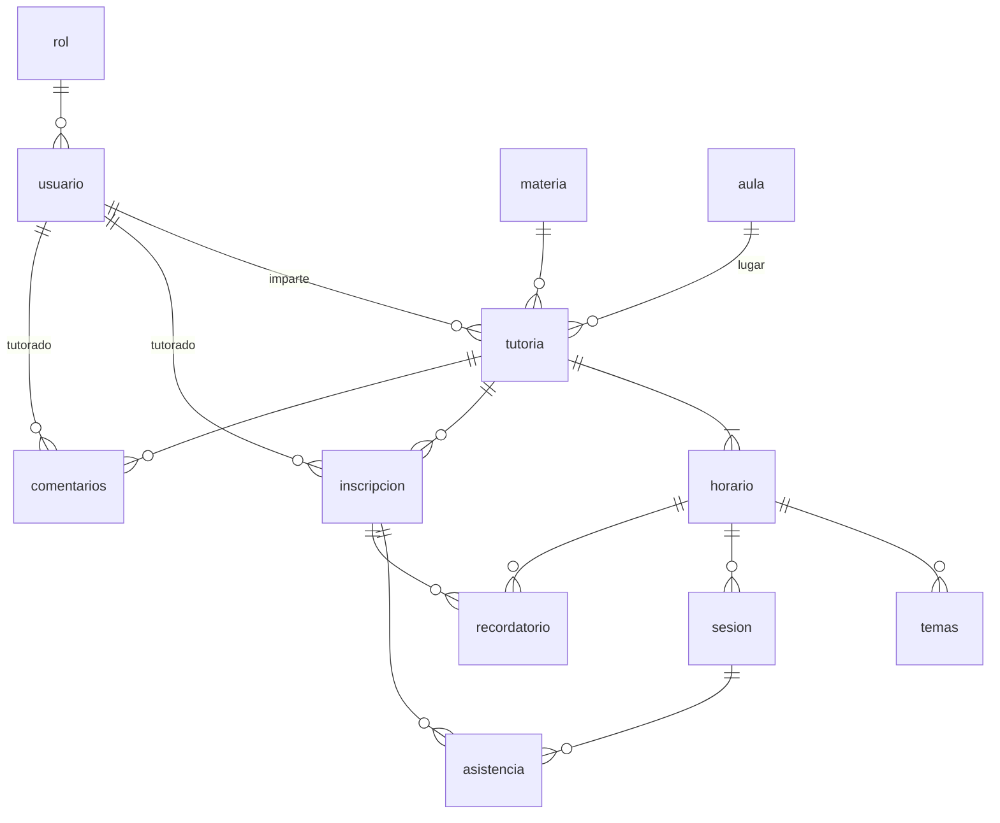

# Modelo de datos

- **Esquema vigente:** [`db/supabase/001_esquema.sql`](../db/supabase/001_esquema.sql) (PostgreSQL / Supabase).
- **Diagrama:** [`db/TutorConnect.dbml`](../db/TutorConnect.dbml). Pégalo en [dbdiagram.io](https://dbdiagram.io/d) para regenerar la imagen.
- **Origen:** `TutorConnect.sql` (dbdiagram, incluido al final), con los cambios de la sección [Cambios aplicados](#cambios-aplicados-al-esquema-recibido).

Se crea una **BD nueva**: no se migran datos, porque los anteriores eran de prueba. Al arrancar, Hibernate valida (`ddl-auto=validate`) que las entidades coincidan con este esquema; si alguien cambia una tabla sin actualizar el código, el backend no arranca.

## Crear la BD en Supabase

1. **Dashboard → SQL Editor → New query**: pega y ejecuta los scripts en orden.

   | Script | Contenido |
   |---|---|
   | `001_esquema.sql` | **Destructivo**: borra las tablas del esquema anterior y del actual. Crea el esquema, activa RLS y siembra `rol` y `aula` (provisional). |
   | `002_datos_prueba.sql` | Opcional. Catálogo real de Ingeniería de Software, plan 2023 (54 EE, NRC aleatorios), y datos de los mockups: 11 tutorías, 46 inscripciones, historial. Rechaza ejecutarse si ya hay datos. |
   | `003_materias_plan_2019.sql` | Opcional. 44 EE del plan 2019 de Administración (NRC sintéticos). |
   | `004_contrasenas.sql` | Solo para una BD creada antes del login con contraseña: agrega `usuario.pwd_hash` y la restricción de credenciales sin borrar datos. Se aplica **antes** de desplegar el backend. |

2. **Cadena de conexión:** Project Settings → Database → Connection string (JDBC). Va en `DB_URL`, y el usuario y la contraseña en `DB_USERNAME` y `DB_PASSWORD`.
3. **Administradores:** se asignan por SQL con su contraseña (ver [AUTENTICACION.md § 5](AUTENTICACION.md#5-administradores)).

### RLS (Row Level Security)

Supabase expone el esquema `public` por su API REST con la *anon key*. El script **activa RLS sin políticas** en todas las tablas y revoca los permisos de `anon` y `authenticated`, así que nadie puede leer ni escribir por esa vía. El backend se conecta por JDBC con el usuario `postgres`, dueño de las tablas, al que RLS no le aplica. Si en el futuro el backend usa otro rol, habrá que agregar políticas para ese rol o darle `BYPASSRLS`.

## Tablas

| Tabla | Descripción | Columnas clave |
|---|---|---|
| `rol` | Catálogo: `TUTORADO`, `TUTOR`, `ADMIN`. | `rol` único |
| `usuario` | Persona que entra con matrícula o correo y contraseña. | PK `matricula` (con `S`); `correo` único y en minúsculas; `id_rol`; `pwd_hash` (BCrypt); `proveedor` + `id_externo` de las cuentas de Microsoft/Google |
| `materia` | Experiencia Educativa (EE). | `identificador` (= NRC) único |
| `aula` | Catálogo de lugares. | PK (`edificio`, `aula`) |
| `tutoria` | Tutoría recurrente de un tutor sobre una EE, en un lugar fijo. | `id_materia`, `matricula_tutor`, FK (`edificio`, `aula`), `estado` (`ACTIVA`/`INACTIVA`) |
| `horario` | Bloque semanal de la tutoría (lunes a viernes). | `id_tutoria`, `dia`, `hora_inicio` < `hora_fin`, `estado` (`ACTIVO`/`INACTIVO`) |
| `temas` | Temas de un horario (máx. 10, 60 caracteres). | `id_horario`; único (`id_horario`, `lower(tema)`) |
| `inscripcion` | Inscripción de un tutorado **a una tutoría**. | `id_tutoria`, `matricula_tutorado`, `estado` (`ACTIVA`/`BAJA`/`BAJA_AUTOMATICA`); única `ACTIVA` por tutorado y tutoría |
| `sesion` | Ocurrencia de un horario en una fecha; solo existe al abrir la lista o al cancelar. | único (`id_horario`, `fecha`); `fecha_cancelada`, `fecha_lista_abierta`, `fecha_lista_cerrada`, `fecha_aviso_cierre` |
| `asistencia` | Marca de un inscrito en una sesión. | único (`id_sesion`, `id_inscripcion`); `asistio boolean NOT NULL` |
| `recordatorio` | Recordatorios enviados (evita duplicados). | único (`id_inscripcion`, `id_horario`, `fecha`) |
| `comentarios` | Sugerencias de tutorados por tutoría. | `matricula_tutorado`, `id_tutoria`, `fecha_comentario` |



**Respecto al esquema anterior:**

- **Se eliminan:** `permisos`, `asistencia.calificacion`. `usuario.pwd` (texto plano) se reemplaza por `usuario.pwd_hash` (BCrypt).
- **Cambian:**
  - `apellidoP` y `apellidoM` se unen en `apellidos`;
  - `matricula` vuelve a `varchar`;
  - `materia.nrc` pasa a `identificador`.
- **Se agregan:** `aula`, `sesion`, `inscripcion`, `recordatorio`.

---

## Cambios aplicados al esquema recibido

Todos están en `001_esquema.sql` y en el DBML.

### 1. `usuario`: contraseña, proveedor y pre-registro

- `pwd_hash VARCHAR(100)`: hash BCrypt de la contraseña. Nunca se guarda la contraseña.
- `proveedor`: `LOCAL` (entra con contraseña), `MICROSOFT` o `GOOGLE` (cuentas creadas con el login anterior, junto con `id_externo` = claim `sub`), o `NULL` (pre-registro).
- `ck_usuario_credencial` solo admite tres combinaciones: pre-registro (las tres columnas en `NULL`), `LOCAL` con `pwd_hash`, o proveedor externo con `id_externo` y sin `pwd_hash`. El pre-registro es la lista de tutores autorizados: el signup lo reclama. Detalle en [AUTENTICACION.md § 3](AUTENTICACION.md#3-estados-de-una-cuenta).
- Para una BD que ya existía: `004_contrasenas.sql` hace este cambio sin borrar datos.

Además, `correo` se guarda en minúsculas (`CHECK`).

### 2. `inscripcion`: ligada a la tutoría en lugar del horario

**Pregunta:** "Te inscribes a la tutoría, pero tu baja se basa en los horarios a los que faltaste. ¿Se recomiendan cambios?"

**Respuesta: sí.** Se cambió `inscripcion.id_horario` por `inscripcion.id_tutoria`. El dato de "a qué horario faltaste" no se pierde, porque ya está en `asistencia → sesion → horario`.

| | Una fila por horario (esquema recibido) | Una fila por tutoría (aplicado) |
|---|---|---|
| Inscribirse | N inserts (uno por horario) en una transacción | 1 insert |
| Darse de baja / baja automática | Actualizar N filas; si falla a medias, quedan estados mezclados | Actualizar 1 fila |
| Cupo | `COUNT(DISTINCT matricula)` sobre todos los horarios | `COUNT(*)` |
| Evitar doble inscripción | Índice parcial por horario; no impide estar en un horario sí y en otro no | Índice único parcial (`id_tutoria`, `matricula`) `WHERE estado='ACTIVA'` |
| ¿Aporta información? | No: los horarios solo cambian sin inscritos (RN-5), así que todo inscrito está siempre en **todos** los horarios | — |
| Saber en qué horario faltó | `asistencia → inscripcion → horario` | `asistencia → sesion → horario` |

Como una tutoría puede tener dos horarios el mismo día, `recordatorio` ganó `id_horario` y su llave única es (`id_inscripcion`, `id_horario`, `fecha`).

### 3. Catálogo de edificios y aulas [S8]

La tabla `aula` (`edificio`, `aula`), con una FK compuesta desde `tutoria`, alimenta `GET /catalogos/edificios`. **El script siembra edificios 1–2 con aulas 1–12 como provisional**; hay que sustituirlo por la lista real de la BD institucional.

### 4. `sesion.fecha_aviso_cierre` [S7]

Marca que ya se envió el correo de "lista sin cerrar", para que el proceso que corre cada minuto lo envíe una sola vez.

### 5. Restricciones de integridad

| Restricción | Regla |
|---|---|
| `ck_tutoria_estado` | `ACTIVA` / `INACTIVA`. |
| `ck_horario_estado` | `ACTIVO` / `INACTIVO`. |
| `ck_horario_dia` | Lunes a viernes. |
| `ck_horario_horas`, `ck_sesion_horas` | `hora_inicio < hora_fin`. |
| `ck_inscripcion_estado` | `ACTIVA` / `BAJA` / `BAJA_AUTOMATICA`. |
| `ck_inscripcion_baja` | `fecha_baja` se llena si y solo si el estado no es `ACTIVA`. |
| `ck_sesion_origen` | Una fila de sesión existe solo si se abrió la lista o se canceló. |
| `ck_sesion_cancelada` | No se cancela con lista abierta. |
| `ck_sesion_cierre` | No se cierra sin abrir. |
| Textos (`ck_*_texto`, `ck_temas_tema`, `ck_materia_nombre`) | No vacíos. |

### Notas

- **Borrado:** ninguna FK tiene `ON DELETE CASCADE`. Es intencional: el historial (sesiones, asistencias, inscripciones) nunca se borra en cascada. Por eso eliminar una EE con tutorías falla y los horarios se desactivan en vez de borrarse.
- **Zona horaria:** las columnas `timestamptz` guardan el instante absoluto. Las columnas `date` y `time` (`sesion.fecha`, `horario.hora_inicio`) se interpretan en `America/Mexico_City`, sin importar la zona del servidor ni de Supabase (UTC).

---

## Esquema recibido (`TutorConnect.sql`)

<details>
<summary>Ver DDL completo</summary>

```sql
CREATE TABLE "tutoria" (
  "id_tutoria" INT GENERATED BY DEFAULT AS IDENTITY PRIMARY KEY,
  "id_materia" int NOT NULL,
  "matricula_tutor" varchar(50) NOT NULL,
  "edificio" int NOT NULL,
  "aula" int NOT NULL,
  "estado" varchar(50) NOT NULL
);

CREATE TABLE "materia" (
  "id_materia" INT GENERATED BY DEFAULT AS IDENTITY PRIMARY KEY,
  "materia" varchar(100) NOT NULL,
  "identificador" int UNIQUE NOT NULL
);

CREATE TABLE "inscripcion" (
  "id_inscripcion" INT GENERATED BY DEFAULT AS IDENTITY PRIMARY KEY,
  "id_horario" int NOT NULL,
  "matricula_tutorado" varchar(50) NOT NULL,
  "fecha_inscripcion" timestamptz NOT NULL,
  "estado" varchar(50) NOT NULL,
  "fecha_baja" timestamptz
);

CREATE TABLE "horario" (
  "id_horario" INT GENERATED BY DEFAULT AS IDENTITY PRIMARY KEY,
  "id_tutoria" int NOT NULL,
  "dia" varchar(50) NOT NULL,
  "hora_inicio" time NOT NULL,
  "hora_fin" time NOT NULL,
  "estado" varchar(50) NOT NULL
);

CREATE TABLE "usuario" (
  "matricula" varchar(50) PRIMARY KEY NOT NULL,
  "nombre" varchar(50) NOT NULL,
  "apellidos" varchar(200) NOT NULL,
  "correo" varchar(255) UNIQUE NOT NULL,
  "id_rol" int NOT NULL
);

CREATE TABLE "rol" (
  "id_rol" INT GENERATED BY DEFAULT AS IDENTITY PRIMARY KEY,
  "rol" varchar(50) UNIQUE NOT NULL
);

CREATE TABLE "temas" (
  "id_tema" INT GENERATED BY DEFAULT AS IDENTITY PRIMARY KEY,
  "tema" varchar(60) NOT NULL,
  "id_horario" int NOT NULL
);

CREATE TABLE "comentarios" (
  "id_comentario" INT GENERATED BY DEFAULT AS IDENTITY PRIMARY KEY,
  "matricula_tutorado" varchar(50) NOT NULL,
  "comentario" varchar(255) NOT NULL,
  "id_tutoria" int NOT NULL,
  "fecha_comentario" timestamptz NOT NULL
);

CREATE TABLE "asistencia" (
  "id_asistencia" INT GENERATED BY DEFAULT AS IDENTITY PRIMARY KEY,
  "id_sesion" int NOT NULL,
  "id_inscripcion" int NOT NULL,
  "asistio" boolean NOT NULL
);

CREATE TABLE "sesion" (
  "id_sesion" INT GENERATED BY DEFAULT AS IDENTITY PRIMARY KEY,
  "id_horario" int NOT NULL,
  "fecha" date NOT NULL,
  "hora_inicio" time NOT NULL,
  "hora_fin" time NOT NULL,
  "fecha_cancelada" timestamptz,
  "fecha_lista_abierta" timestamptz,
  "fecha_lista_cerrada" timestamptz
);

CREATE TABLE "recordatorio" (
  "id_recordatorio" INT GENERATED BY DEFAULT AS IDENTITY PRIMARY KEY,
  "id_inscripcion" int NOT NULL,
  "fecha" date NOT NULL,
  "fecha_envio" timestamptz NOT NULL
);

CREATE INDEX ON "inscripcion" ("id_horario", "matricula_tutorado");
CREATE UNIQUE INDEX ON "asistencia" ("id_sesion", "id_inscripcion");
CREATE UNIQUE INDEX ON "sesion" ("id_horario", "fecha");
CREATE UNIQUE INDEX ON "recordatorio" ("id_inscripcion", "fecha");

ALTER TABLE "tutoria" ADD FOREIGN KEY ("id_materia") REFERENCES "materia" ("id_materia") DEFERRABLE INITIALLY IMMEDIATE;
ALTER TABLE "tutoria" ADD FOREIGN KEY ("matricula_tutor") REFERENCES "usuario" ("matricula") DEFERRABLE INITIALLY IMMEDIATE;
ALTER TABLE "inscripcion" ADD FOREIGN KEY ("id_horario") REFERENCES "horario" ("id_horario") DEFERRABLE INITIALLY IMMEDIATE;
ALTER TABLE "inscripcion" ADD FOREIGN KEY ("matricula_tutorado") REFERENCES "usuario" ("matricula") DEFERRABLE INITIALLY IMMEDIATE;
ALTER TABLE "horario" ADD FOREIGN KEY ("id_tutoria") REFERENCES "tutoria" ("id_tutoria") DEFERRABLE INITIALLY IMMEDIATE;
ALTER TABLE "usuario" ADD FOREIGN KEY ("id_rol") REFERENCES "rol" ("id_rol") DEFERRABLE INITIALLY IMMEDIATE;
ALTER TABLE "temas" ADD FOREIGN KEY ("id_horario") REFERENCES "horario" ("id_horario") DEFERRABLE INITIALLY IMMEDIATE;
ALTER TABLE "comentarios" ADD FOREIGN KEY ("matricula_tutorado") REFERENCES "usuario" ("matricula") DEFERRABLE INITIALLY IMMEDIATE;
ALTER TABLE "comentarios" ADD FOREIGN KEY ("id_tutoria") REFERENCES "tutoria" ("id_tutoria") DEFERRABLE INITIALLY IMMEDIATE;
ALTER TABLE "asistencia" ADD FOREIGN KEY ("id_sesion") REFERENCES "sesion" ("id_sesion") DEFERRABLE INITIALLY IMMEDIATE;
ALTER TABLE "asistencia" ADD FOREIGN KEY ("id_inscripcion") REFERENCES "inscripcion" ("id_inscripcion") DEFERRABLE INITIALLY IMMEDIATE;
ALTER TABLE "sesion" ADD FOREIGN KEY ("id_horario") REFERENCES "horario" ("id_horario") DEFERRABLE INITIALLY IMMEDIATE;
ALTER TABLE "recordatorio" ADD FOREIGN KEY ("id_inscripcion") REFERENCES "inscripcion" ("id_inscripcion") DEFERRABLE INITIALLY IMMEDIATE;
```

</details>
